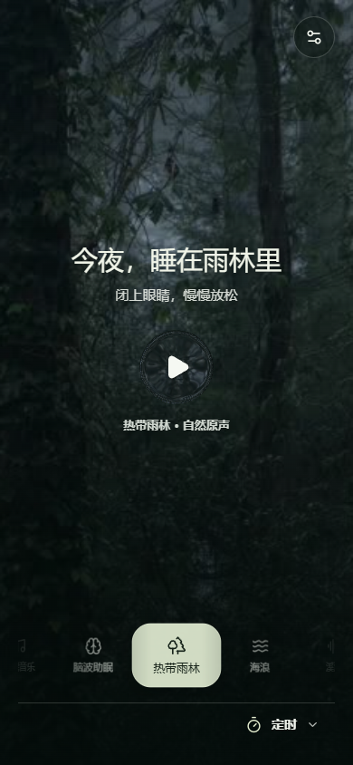
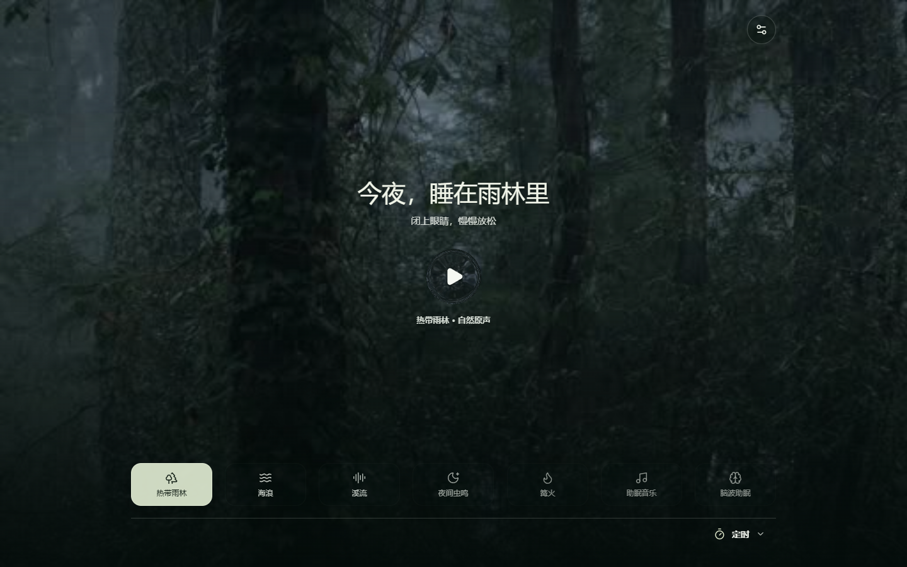

English | [简体中文](README.zh-CN.md)

# Nature Sleep

A personal experimental Android sound player with seven scenes, matching video backgrounds, ten interface languages, and a sleep timer. Audio experiences vary; the app does not promise to improve sleep or replace medical advice or treatment.

## Download and Install

**[Download the latest Android release](https://github.com/tuifeirenshi/nature-sleep/releases/latest)** · [v1.0.1 release](https://github.com/tuifeirenshi/nature-sleep/releases/tag/v1.0.1) · [Version history](docs/release/README.md)

- Android 8.0 or later; phones and tablets. Current published APK: `nature-sleep-v1.0.1.apk`.
- Download the APK from the Release assets and open it on your device. Android may ask you to allow installation from the download app. Installation over an older copy depends on its signing key and version code; uninstalling removes local settings.
- Background playback, lock-screen controls, and liquid glass may vary by device. See the Release notes for limitations and SHA-256.

## Screenshots

Phone and desktop web previews

Captured on 2026-11-07 at 390 × 844 and 1440 × 900. These show the v1.0.1 web interface, not Android device testing. [Screenshot versions](docs/screenshots/README.md).

## Local Preview

Install Git LFS and Node.js. Clone the repository and download the LFS media before starting the preview; a source ZIP may not include the actual media. On Windows, double-click `open-preview.cmd` to open `http://127.0.0.1:8768/`.

[Preview setup and troubleshooting](docs/development/PREVIEW.md)

## Development

The current Android build uses Gradle Wrapper and the Android Gradle Plugin. `build.ps1` is the current Windows entry, not a leftover of the old manual build. Run it only when an APK build is wanted.

- [Build prerequisites, signing, and output paths](docs/development/BUILD.md)
- [Build migration: manual tools to Gradle](docs/development/BUILD_MIGRATION.md)
- [Tool and archive index](tools/README.md)
- [Updating playback media](docs/media/UPDATING_MEDIA.md)

## Repository Guide

- `web/`: player UI and current playback media; `android/`: Android code and media controls.
- `scripts/`: current preview and build helpers; `gradle/`: Gradle Wrapper files.
- `docs/`: [documentation index](docs/README.md), licensing, media, and release records.
- `tools/`: current checks and signing template; `tools/archive/`: historical experiments.
- `docs/archive/`: historical plans and evidence, not current operating instructions.

## License and Media

This is a **source-available project**, not a project distributed under a standard open-source code license. The repository can be viewed and forked on GitHub. No additional permission is granted for copying, modifying, commercial use, or redistribution of the code outside GitHub's platform permissions. Third-party media and icons follow their own licenses. Forks and personal builds are not official releases.

See the [license record](docs/licensing/PROJECT_LICENSES.md) for recorded evidence and unresolved questions, and the [current media catalog](docs/media/MEDIA_CATALOG.md) for files and hashes. Some platform terms still require confirmation; a pending status is not a grant of permission. Historical material is not evidence of current use or redistribution rights. The current playlist is `web/tracks.js`.

## Contributions and Contact

Use Issues for bugs and Discussions for general conversation. No public project email is provided. Suggestions and PRs are welcome, but review, replies, fixes, and merging have no guaranteed deadline. External code will not be merged until code licensing and contribution permissions are decided; media submissions require provenance and author confirmation.

[Contribution policy](docs/development/CONTRIBUTING.md) · [AI and automation rules](docs/development/AI_RULES.md). GitHub does not guarantee a notification for every fork.

## Project Status

This is a personal experimental project with no promise of long-term maintenance, bug-free operation, or compatibility with every device. Features, media, and documentation may change. Windows, iOS, and macOS support is undecided and has no timeline.
