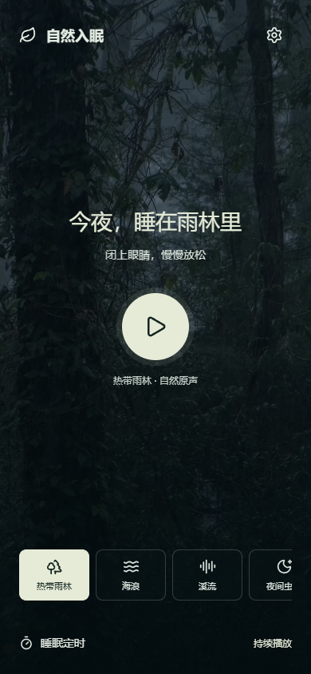
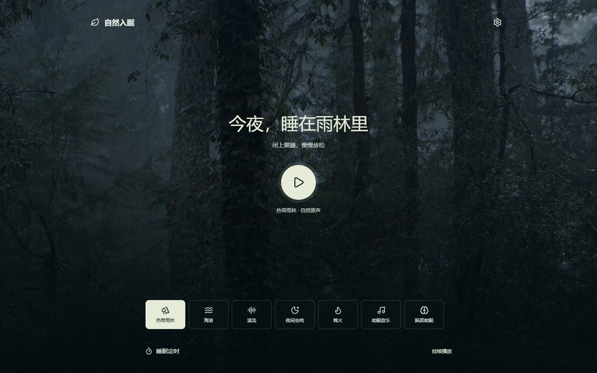

[English](README.md) | 简体中文

# 自然入眠

自然入眠是一款个人实验性质的 Android 声音播放器，包含七种自然音景与助眠声音，并为每种音景配有视频背景。项目仍在调整中，功能、素材和文档都可能变化。声音体验因人而异；本应用不承诺改善睡眠，也不替代医疗建议或治疗。





这是一个**公开源码项目**，不是采用标准开源许可证的项目。公开仓库允许在 GitHub 内查看和 Fork；项目当前没有授予平台外复制、修改、商用或再发布代码的许可。第三方音视频和图标分别依其自身许可证使用。Fork、改版和个人构建不代表官方版本。

## 预览与安装

- 电脑预览：Windows 上双击 `open-preview.cmd`；浏览器打开 `http://127.0.0.1:8768/`。
- Android：从 [GitHub Releases](https://github.com/tuifeirenshi/nature-sleep/releases) 下载 `nature-sleep-v1.0.1.apk`，应用版本为 `1.0.1`。
- Android 8.0 及以上；支持手机和平板。后台播放由 Android 通知控制；实际后台行为可能受设备厂商的省电设置影响。

## 从源码运行

大媒体文件使用 Git LFS。克隆前先安装 Git LFS，然后执行：

```powershell
git lfs install
git clone https://github.com/tuifeirenshi/nature-sleep.git
cd nature-sleep
git lfs pull
git lfs ls-files
```

`git lfs ls-files` 应列出 14 个当前音视频文件。若页面预览或构建提示媒体文件缺失，请确认 `git lfs pull` 已成功，并检查 `web/media/` 中文件不是小型 LFS 指针文本。

## 构建 Android APK

Android 应用通过 Gradle Wrapper 和官方 Android Gradle Plugin 构建。需要 JDK 21、Android SDK Platform 35、Build Tools 35.0.0 和 PATH 中提供 libx264 的 FFmpeg，并设置 `JAVA_HOME` 与 `ANDROID_SDK_ROOT`。运行 `build.ps1` 会先为 APK 生成独立的 4K H.264 视频副本，目标平均码率 9 Mbps，篝火为 30 帧/秒，其余帧率保持原样；网页原素材不变。Wrapper 使用 Gradle 8.9 并校验下载的 SHA-256。签名凭据仅保存在本机，不得提交到 Git；配置方法见 `tools/signing.example.properties`。

```powershell
.\build.ps1
```

签名密钥及密码仅保存在本机，不提交到 Git。首次在另一台电脑构建时，需自行配置 `tools/signing.local.properties`，格式参考 `tools/signing.example.properties`。不要把真实签名密钥或密码发送给他人或上传到仓库。遗失签名密钥会影响后续为同一应用签名更新。

## 素材与授权

第三方许可证据及尚未解决的授权问题见[项目许可证记录](docs/licensing/PROJECT_LICENSES.zh-CN.md)；素材文件路径、哈希、技术信息和处理记录见[当前素材目录](docs/media/MEDIA_CATALOG.zh-CN.md)。部分平台条款仍有待进一步确认；标注“待确认”不代表已经取得授权。

仓库历史可能包含当前版本不再使用的旧素材、候选文件和处理记录。它们仅供历史参考，不代表仍被当前应用使用，也不代表获得了再分发许可。当前播放清单以 `web/tracks.js` 为准。

## 贡献和联系

可以提交问题、建议或 Pull Request，但没有审核或回复时限，也不保证会合并。外部代码贡献在代码许可和贡献授权方式明确前不会合并。媒体贡献必须附来源 URL、作者、许可证、下载日期、再分发及修改权限和文件 SHA-256，并等待项目作者确认。

目前不公开项目邮箱。可使用 GitHub Issues 报告问题、使用 Discussions 交流；是否处理由项目作者决定。GitHub 不保证在有人 Fork 时通知仓库作者。详见 [贡献说明](docs/development/CONTRIBUTING.zh-CN.md) 与 [AI 修改规则](docs/development/AI_RULES.zh-CN.md)。

## 当前状态

这是个人实验项目，不承诺长期维护、无 Bug 或兼容所有设备。当前发布版本的功能和素材可能继续变化。Windows、iOS、macOS 等其他平台尚未确定，没有时间表。
