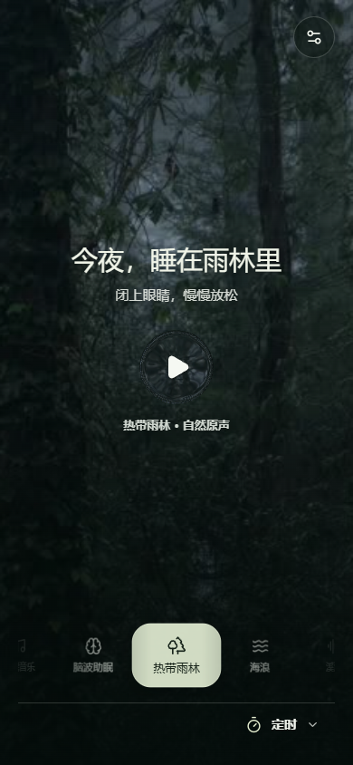
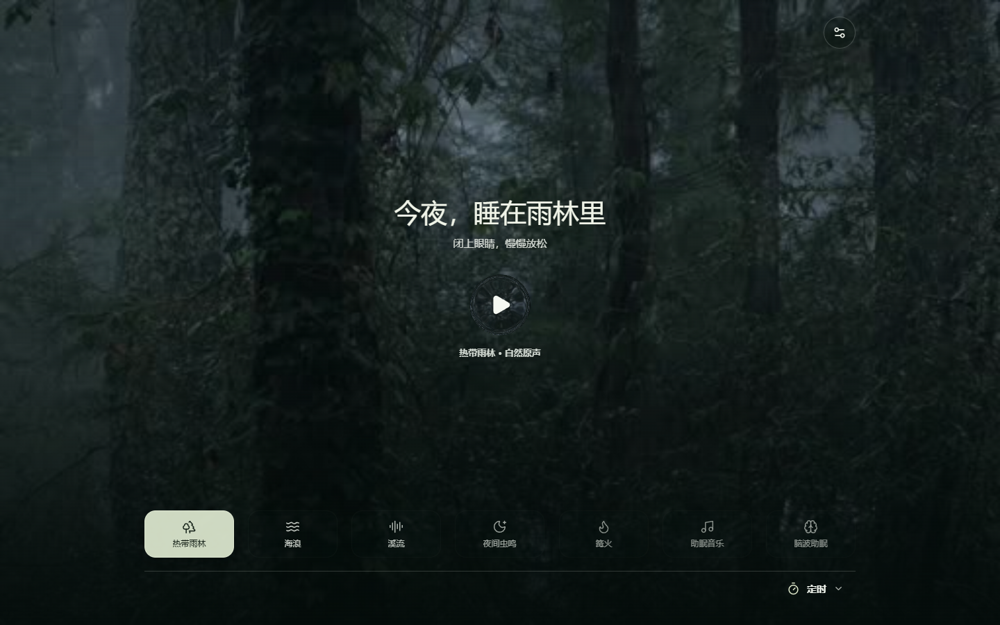

[English](README.md) | 简体中文

# 自然入眠

个人实验性质的 Android 声音播放器，包含七种声音场景、对应的视频背景、十种界面语言和定时功能。声音体验因人而异；本应用不承诺改善睡眠，也不替代医疗建议或治疗。

## 下载与安装

**[下载最新 Android 版本](https://github.com/tuifeirenshi/nature-sleep/releases/latest)** · [v1.0.1 发布页](https://github.com/tuifeirenshi/nature-sleep/releases/tag/v1.0.1) · [版本记录](docs/release/README.zh-CN.md)

- Android 8.0 及以上，支持手机和平板。当前已发布 APK：`nature-sleep-v1.0.1.apk`。
- 在发布页附件中下载 APK，再用设备打开安装。系统可能要求允许通过下载应用安装。能否覆盖旧版取决于签名及内部版本号；卸载会清除本地设置。
- 后台播放、锁屏控制和液态玻璃可能因设备而异。限制及 SHA-256 见对应版本的发布说明。

## 界面截图

展开手机与电脑网页预览

截图于 2026-11-07 按 390 × 844 和 1440 × 900 尺寸截取，展示 v1.0.1 网页界面，不代表 Android 真机测试。[截图版本说明](docs/screenshots/README.zh-CN.md)。

## 本地预览

先安装 Git LFS 和 Node.js，克隆仓库并下载 LFS 媒体，再启动预览；直接下载源码 ZIP 可能不包含实际媒体。Windows 上双击 `open-preview.cmd`，打开 `http://127.0.0.1:8768/`。

[预览准备与问题排查](docs/development/PREVIEW.zh-CN.md)

## 开发

当前 Android 构建使用 Gradle Wrapper 和 Android Gradle Plugin。根目录 `build.ps1` 是当前 Windows 入口，不是旧手工构建脚本残留。只在需要打包 APK 时运行。

- [构建环境、签名和输出路径](docs/development/BUILD.zh-CN.md)
- [构建迁移：从手工工具到 Gradle](docs/development/BUILD_MIGRATION.zh-CN.md)
- [工具与归档索引](tools/README.zh-CN.md)
- [更新播放素材](docs/media/UPDATING_MEDIA.zh-CN.md)

## 仓库目录

- `web/`：播放器界面和当前播放素材；`android/`：安卓代码与媒体控制。
- `scripts/`：当前预览和构建辅助脚本；`gradle/`：Gradle Wrapper 配套文件。
- `docs/`：[文档目录](docs/README.zh-CN.md)、许可、素材及发布记录。
- `tools/`：当前检查工具和签名模板；`tools/archive/`：历史实验。
- `docs/archive/`：历史计划与证据，不是当前操作说明。

## 许可与素材

这是一个**公开源码项目**，不是采用标准开源许可证的项目。允许在 GitHub 内查看和 Fork；项目当前没有额外授予平台外复制、修改、商用或再发布代码的许可。第三方素材和图标分别依其自身许可证使用。Fork 和个人构建不代表官方版本。

[许可记录](docs/licensing/PROJECT_LICENSES.zh-CN.md)列出既有证据及待确认事项，[当前素材目录](docs/media/MEDIA_CATALOG.zh-CN.md)列出文件和哈希。部分平台条款仍待确认；待确认不代表已获许可。历史材料不代表当前仍在使用，也不是再分发授权依据。当前播放清单为 `web/tracks.js`。

## 贡献与联系

使用 Issues 报告问题，使用 Discussions 交流。目前不公开项目邮箱。欢迎建议和 PR，但不承诺审核、回复、修复或合并期限。代码许可和贡献授权方式明确前不合并外部代码；媒体提交须提供来源材料并由作者确认。

[贡献规则](docs/development/CONTRIBUTING.zh-CN.md) · [AI 与自动化规则](docs/development/AI_RULES.zh-CN.md)。GitHub 不保证在每次有人 Fork 时通知作者。

## 项目状态

个人实验项目，不承诺长期维护、无 Bug 或兼容所有设备。功能、素材和文档可能变化。Windows、iOS、macOS 支持尚未确定，没有时间表。
